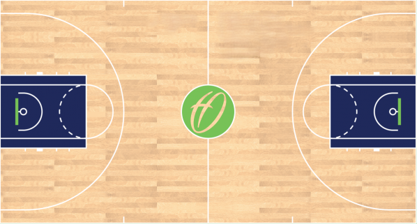
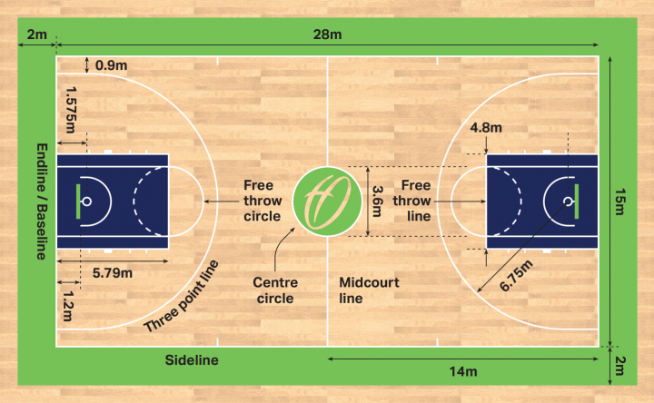

# Basketball Video Analytics

A computer vision pipeline for basketball game footage. Give it a video and it tracks the players and the ball,
works out which team each player is on, and figures out possession, passes, interceptions and how fast and far
each player moves. The result is the same video with all of that drawn on top, plus a small top-down view of
the court.

This project is built on [abdullahtarek/basketball_analysis](https://github.com/abdullahtarek/basketball_analysis).
The pipeline code, training notebooks and pretrained model weights come from that repository.

## What it does

- Detects players and the ball with fine-tuned Ultralytics YOLO models.
- Tracks players with ByteTrack (from the `supervision` library) so each one keeps the same ID from frame to
  frame.
- Splits players into two teams with a zero-shot Fashion-CLIP model that decides whether a shirt looks like a
  "white shirt" or a "dark blue shirt".
- Decides who has the ball and counts passes and interceptions for each team.
- Finds keypoints on the court and uses a homography to place every player on a top-down tactical view.
- Calculates each player's speed in km/h and distance in metres.

## Getting started

### 1. Get the models

The pipeline needs three model files in `models/`:

- `player_detector.pt`
- `ball_detector_model.pt`
- `court_keypoint_detector.pt`

You can download the pretrained weights from the links in the
[original project's README](https://github.com/abdullahtarek/basketball_analysis#-training-the-models), or train
your own with the notebooks in `training_notebooks/`.

### 2. Run it with Python

```bash
git clone https://github.com/Manishmaurya89/Basketball-Analytics-Estimation-Using-Object-Segmentation-.git
cd Basketball-Analytics-Estimation-Using-Object-Segmentation-

pip install -r requirements.txt
python main.py path/to/game.mp4 --output_video output_videos/output_video.avi
```

### Or run it with Docker

Put the model files in `models/` first so they get copied into the image.

```bash
cd Basketball-Analytics-Estimation-Using-Object-Segmentation-
docker build -t basketball-analytics .
docker run \
  -v "$(pwd)/input_videos:/app/input_videos" \
  -v "$(pwd)/output_videos:/app/output_videos" \
  basketball-analytics input_videos/game.mp4
```

The output video is saved to `output_videos/output_video.avi`.

`main.py` caches detection results in `stubs/` to save time on repeat runs. A cached result is only used when
its frame count matches the input video, so a new video is always processed from scratch.

## How it works

```
Input video
  -> YOLO finds players, the ball and court keypoints
  -> ByteTrack gives each player a consistent ID
  -> Fashion-CLIP sorts players into Team 1 and Team 2 by shirt
  -> Possession: a player has the ball when it's inside or close to their box.
     A change between teammates is a pass, a change to the other team is an interception.
  -> A homography maps players onto a top-down court for speed and distance
  -> Everything is drawn onto the output video
```

## The court

The tactical view draws every player onto this top-down court (`images/basketball_court.png`):

<p align="center">
  
</p>

Speed and distance are measured on a standard 28 m × 15 m court. The court keypoints are placed using these
measurements (`images/basketball-court-dimensions.png`):

<p align="center">
  
</p>

Court diagrams from [The Hoops Geek](https://www.thehoopsgeek.com/basketball-court-dimensions/).

## Project layout

```
Basketball-Analytics-Estimation-Using-Object-Segmentation-/
├── main.py                          runs the whole pipeline
├── configs/                         model and output paths
├── trackers/                        player and ball detection and tracking
├── team_assigner/                   Fashion-CLIP team assignment
├── ball_aquisition/                 who has the ball
├── pass_and_interception_detector/  passes and interceptions
├── court_keypoint_detector/         court keypoints
├── tactical_view_converter/         homography to the top-down view
├── speed_and_distance_calculator/   player speed and distance
├── drawers/                         draws everything onto each frame
├── utils/                           video input/output, box helpers, caching
├── training_notebooks/              notebooks for training the three YOLO models
├── images/                          court images for the tactical view
├── stubs/                           cached results for the sample video
├── Dockerfile
└── requirements.txt
```

## Built with

Ultralytics YOLO, ByteTrack (`supervision`), Fashion-CLIP (Hugging Face Transformers), OpenCV, PyTorch, Pandas
and NumPy. The training datasets are managed with Roboflow.

## Contact

Questions: manish.maurya0408@gmail.com
